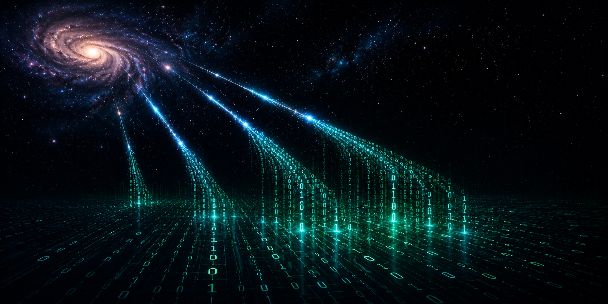

  

# Hi, I'm Dimitris 👋

### Particle Physics | Scientific Software | Computational Research

I'm a Physics graduate and MSc candidate in Particle Physics, with a focus on scientific software development, computational physics, and experimental data analysis.

I build reproducible analysis pipelines that connect physical models, numerical simulations, and real experimental data.

My work spans high-energy physics, Monte Carlo simulation, particle-level reconstruction, signal processing, and statistical analysis.

**Turning physics into code.**

---

## 🔬 Featured Projects

### ⚛️ [Collider → Cosmos](https://github.com/naris93-phcs/collider-to-cosmos)
**High-Energy Physics | C++17 | ROOT | Monte Carlo Simulation**

Developing an ATLAS-inspired same-sign WW scattering analysis, connecting collider phenomenology with physics beyond the Standard Model.

- End-to-end MadGraph5_aMC@NLO → Pythia8 → HepMC → FastJet → ROOT workflow
- Particle-level lepton and jet reconstruction
- Fiducial event selection and validated cutflow
- ROOT TTrees and kinematic distributions
- Preparing differential comparisons with published ATLAS measurements

**Current milestone:** v0.2.0 — Standard Model fiducial analysis baseline.

### 🌌 [Cosmic Muon Lifetime Analysis](https://github.com/naris93-phcs/muon-lifetime-analysis)
**Experimental Physics | Python | Signal Processing**

Analysis of real oscilloscope waveform data to identify candidate muon decays and estimate the muon lifetime.

- Waveform processing and event selection
- Statistical lifetime estimation
- Scientific visualization and reproducible analysis

### 📡 [Pulsar Signal Analysis](https://github.com/naris93-phcs/pulsar-signal-analysis)
**Astrophysics | Python | Numerical Methods**

Scientific signal-analysis toolkit for simulated pulsar observations.

- FFT-based periodicity detection
- Phase folding and pulse-profile analysis
- Signal-to-noise estimation
- Monte Carlo validation

---

## 🛠️ Technical Stack

**Languages:** Python, C, C++, SQL

**Scientific Computing:** NumPy, Pandas, SciPy, Matplotlib, ROOT

**HEP & Simulation:** MadGraph5_aMC@NLO, Pythia8, HepMC, FastJet

**Development:** Linux, WSL2, Git, GitHub, CMake, VS Code, Jupyter

**Methods:** Monte Carlo Simulation, Statistical Inference, Signal Processing, Numerical Analysis, Scientific Visualization

---

## 🎯 Research & Career Interests

- Experimental Particle Physics & Collider Phenomenology
- Scientific Software Engineering
- Research Computing & Computational Physics
- Data Analysis & Data Science
- High-Energy Physics Simulation
- Physics Beyond the Standard Model

I'm interested in opportunities where physics, scientific computing, and software engineering intersect, including research laboratories, scientific technology, and data-driven engineering teams.

---

*From physical principles to computational models, from simulation to evidence.*

**Turning physics into code.**
